---
# ───────────────────────────── WordPress + Rank Math (paste into the post's Rank Math panel) ─────────────────────────────
post_title: "CFB Gagetown fire: artillery set the training area burning, and satellites watched it for two days"
slug: cfb-gagetown-fire-artillery-lawfield-impact-area
permalink: https://primerogueinc.com/blog/cfb-gagetown-fire-artillery-lawfield-impact-area/
author: Kevin J.S. Duska Jr.
date: 2026-10-30
status: draft
categories: [Investigations, Canadian Armed Forces]
tags: [CFB Gagetown, wildfire, Lawfield Impact Area, Royal Canadian Artillery School, CFB Wainwright, satellite analysis, NASA FIRMS, GOES-19, open-source intelligence, New Brunswick]
featured_image: cfb-gagetown/2026-10-29/maps/branded/11-cfb-gagetown-fire-social-card.jpg
rank_math:
  focus_keyword: CFB Gagetown fire
  secondary_keywords: [Gagetown wildfire, Lawfield Impact Area, Base Gagetown artillery fire, CFB Wainwright fire, NASA FIRMS satellite fire]
  seo_title: "CFB Gagetown fire: artillery, a 12:22 report and two days of satellite data %sep% %sitename%"
  meta_description: "Artillery fire into the Lawfield Impact Area started the CFB Gagetown fire on Oct. 28. Satellites tracked it for two days. What the base told Prime Rogue."
  canonical_url: https://primerogueinc.com/blog/cfb-gagetown-fire-artillery-lawfield-impact-area/
  robots: [index, follow, max-image-preview:large]
  schema:
    type: NewsArticle
    headline: "CFB Gagetown fire: artillery set the training area burning, and satellites watched it for two days"
    article_section: Investigations
    date_published: 2026-10-30
    keywords: "CFB Gagetown, wildfire, Lawfield Impact Area, artillery, satellite, CFB Wainwright"
    location: "CFB Gagetown Range and Training Area, New Brunswick, Canada (45.749 N, 66.260 W)"
  open_graph:
    title: "Artillery set CFB Gagetown's training area burning. Satellites watched for two days."
    description: "A 105 mm howitzer course, a Moderate fire-danger rating, 25 hectares burned: the full sequence of the Oct. 28 fire, from orbit and from the base."
    image: cfb-gagetown/2026-10-29/maps/branded/11-cfb-gagetown-fire-social-card.jpg
  twitter:
    card: summary_large_image
    title: "CFB Gagetown fire: the full sequence"
    description: "Artillery into the Lawfield Impact Area, reported to Range Control at 12:22 p.m., seen from orbit 24 minutes later, still burning a day on."
    image: cfb-gagetown/2026-10-29/maps/branded/11-cfb-gagetown-fire-social-card.jpg
  pillar_content: false
  breadcrumbs_title: CFB Gagetown fire
image_alts:
  01-cfb-gagetown-fire-region.jpg: "Satellite map of the lower Saint John River valley showing Fredericton, Oromocto and Gagetown village, with the Oct. 28, 2026 fire marked in the CFB Gagetown training area"
  02-cfb-gagetown-fire-locator.jpg: "Satellite map of the CFB Gagetown training area with VIIRS fire detections of Oct. 28, 2026 clustered in a large open clearing west-south-west of Gagetown village"
  03-cfb-gagetown-fire-closeup.jpg: "Close-up satellite image of the clearing with 35 VIIRS fire-detection boxes from five satellite passes on Oct. 28, 2026"
  04-cfb-gagetown-fire-swir.jpg: "Short-wave infrared satellite view of the same clearing, showing the fire detections on dry, sparsely vegetated ground"
  08-cfb-gagetown-fire-3d-from-north.jpg: "3D view of the CFB Gagetown clearing from the north, with spikes showing the heat output of each satellite fire detection"
  09-cfb-gagetown-fire-timeline.jpg: "Chart of fire radiative power over CFB Gagetown from GOES-19 and VIIRS on Oct. 28–29, 2026, with the base's reported times marked"
  10-cfb-gagetown-fire-day-two.jpg: "Satellite image showing Oct. 29 fire detections on the southern side of the area that burned on Oct. 28"
  11-cfb-gagetown-fire-social-card.jpg: "Prime Rogue card: Artillery started it. Orbit saw it 24 minutes later. With a GOES-19 fire-power chart for the afternoon of Oct. 28, 2026"
  12-cfb-gagetown-fire-base-answers.jpg: "Summary card of CFB Gagetown's written answers: artillery into Lawfield Impact Area, reported 12:22 p.m., 105 mm LG1 course, Moderate fire danger, 25 hectares, no injuries"
  13-cfb-gagetown-fire-first-hours.jpg: "Chart of GOES-19 and VIIRS fire power over CFB Gagetown from noon to 4 p.m. on Oct. 28, 2026, with the base's 12:15 and 12:22 times and the first satellite heat at 12:46"
  14-cfb-gagetown-fire-how-the-story-broke.jpg: "Timeline of how the CFB Gagetown fire story broke, from the 12:22 p.m. report to Range Control to the base's written answers"
  15-cfb-gagetown-wainwright-compared.jpg: "Comparison table of the CFB Wainwright fire of Oct. 17 and the CFB Gagetown fire of Oct. 28, 2026"
---

# CFB Gagetown fire: artillery set the training area burning, and satellites watched it for two days

*By Kevin J.S. Duska Jr. · Prime Rogue Inc. · Oct. 30, 2026*

**A fire started by artillery shooting into the Lawfield Impact Area burned through part of the CFB Gagetown training area in New Brunswick on Oct. 28 and was still burning the next afternoon. The base says it was reported to Range Control at 12:22 p.m. ADT, during a Royal Canadian Artillery School course firing the 105 mm LG1 howitzer, under a Moderate fire-danger rating. No one was hurt. Public satellite data shows how it unfolded, hour by hour.**

It came eleven days after the fire at CFB Wainwright, Alta., where four soldiers died and 39 were injured on Oct. 17.

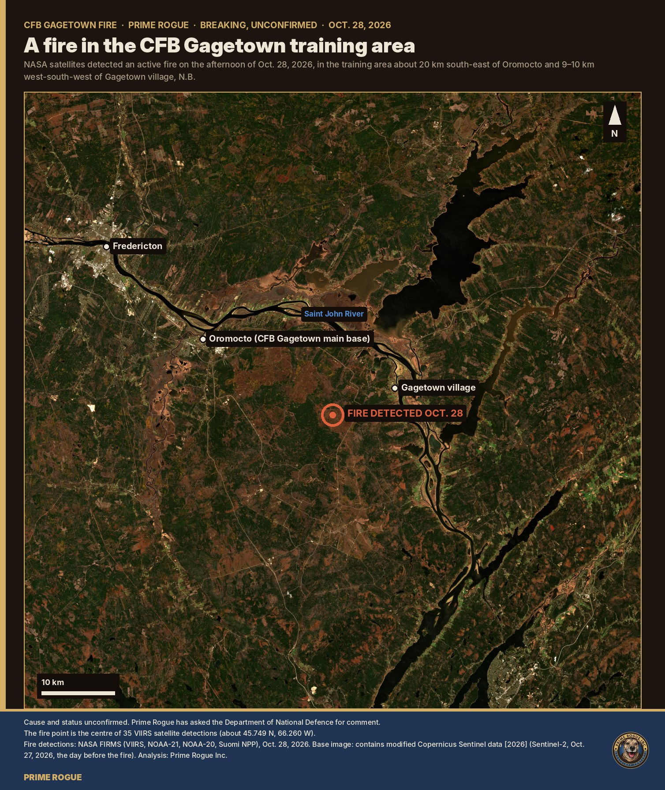

## What the base says happened

CFB Gagetown's public affairs office answered Prime Rogue's questions in writing on Oct. 29. National Defence did not reply to an earlier set of questions sent to the department by its noon deadline on Oct. 29.

- **Cause.** "The wildfire was started by artillery shooting into Lawfield Impact Area," wrote Capt. Robynn Still, public affairs officer for Canadian Support Group (Atlantic). "As the fall of artillery shot is done under observation, the detection of this fire would have occurred very rapidly after its ignition." The cause "remains under investigation," she added, but the fire "originated within an active impact area of the training range."
- **When.** "The fire was reported to Range Control at 1222 hrs on 28 October." Training restrictions were put in place at 12:15 p.m.
- **Who was firing.** "At the time the wildfire was reported, Royal Canadian Artillery School (RCAS) Forward Observation Officer (FOO) Course was conducting training involving the 105 mm LG1 howitzer." All training near the fire was then suspended.
- **Fire danger.** "A fire danger rating of Moderate was in effect on October 28." Under the range safety orders, the base said, there were restrictions on "certain pyrotechnic and illumination munitions in areas where they could increase fire risk." The base said the training "was carried out in accordance with those requirements."
- **Size.** On Oct. 29, about 25 hectares had burned, with about 12 hectares still actively burning, "in the northeastern portion of the Gagetown Range and Training Area."
- **Safety.** No one had to evacuate or move, and there were no injuries. There was "currently no risk to the public, Canadian Armed Forces members, or civilian employees."
- **Firefighting.** Wildland Fire Management Services is leading the response. Helicopter water-bucket drops were planned for the afternoon of Oct. 29, and an armoured dozer from 4 Engineer Support Regiment was being brought in. "Due to the presence of unexploded ordnance within portions of the training area, some suppression methods cannot be used in affected areas."
- **After Wainwright.** Asked whether anything had changed since Oct. 17, the base said the Armed Forces "continually reviews wildfire mitigation measures, range safety procedures, and training practices," and referred CAF-wide questions to "the appropriate authorities."

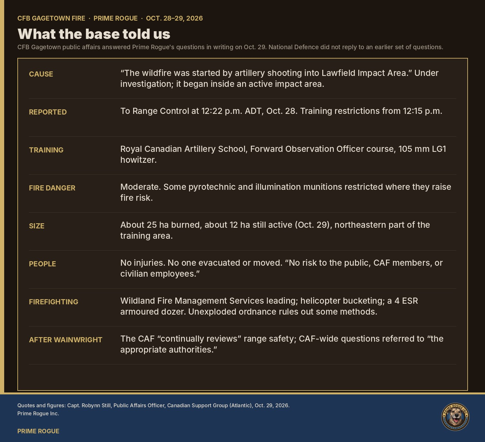

One point in the answers needs clearing up. The base describes Wildland Fire Management Services in one answer as "New Brunswick's provincial wildfire agency" and in another as "a base organization independent of the Base Fire Services."

## What the satellites saw

The fire was visible from orbit for most of two days. Three kinds of public satellite data, read together, give the sequence. Times are ADT.

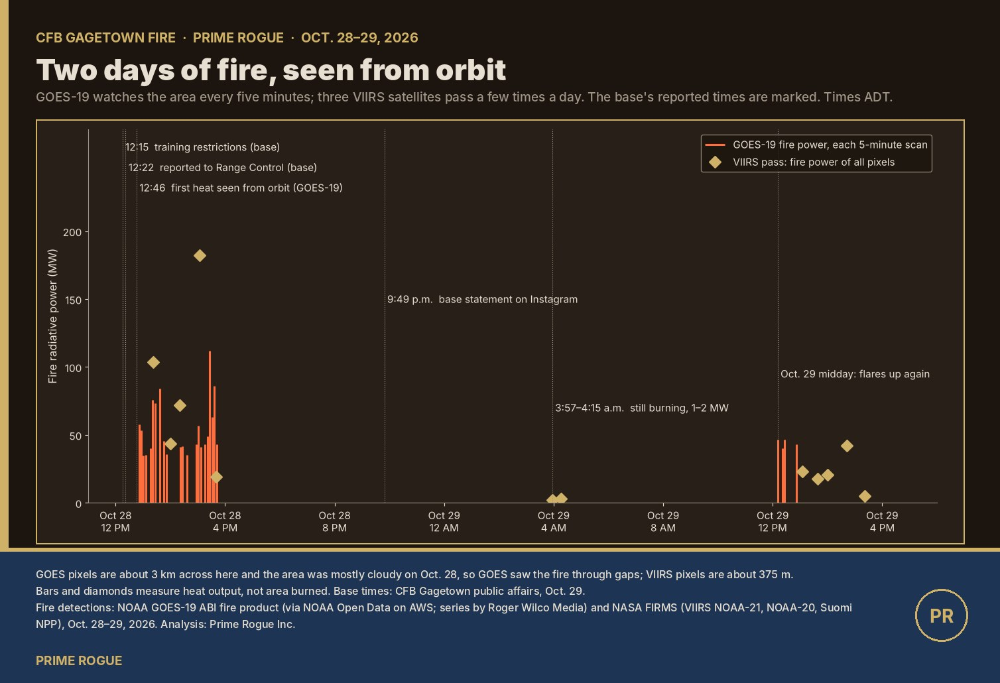

**Oct. 28, midday: first heat.**
- GOES-19, the U.S. weather satellite that images eastern North America every five minutes, recorded its first heat over the area at **12:46 p.m.** That's 24 minutes after the time the base gives for the report to Range Control. Its first measured fire power came at 12:50–12:51 p.m., 52–58 megawatts.
- The area was mostly cloud-covered all afternoon, so GOES saw the fire only through gaps. Its pixels are about 3 km across here: it can confirm a fire, not draw it.

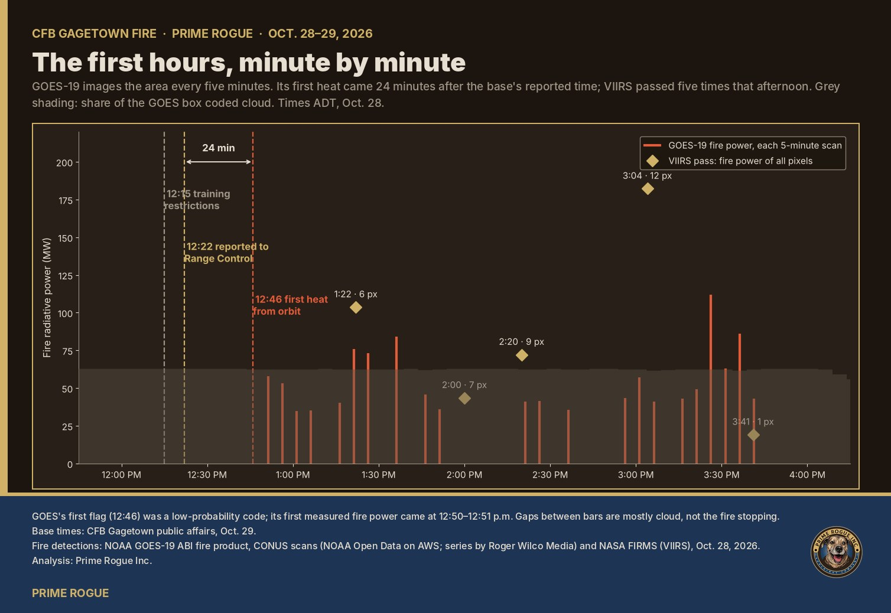

**Oct. 28, afternoon: five passes.** NASA's three VIIRS satellites passed five times between 1:22 and 3:41 p.m. and recorded **35 fire detections**:

| Pass (ADT) | Satellite | Detections | Peak (MW) |
|---|---|---|---|
| 1:22 p.m. | NOAA-21 | 6 | 30.5 |
| 2:00 p.m. | Suomi NPP | 7 | 7.4 |
| 2:20 p.m. | NOAA-20 | 9 | 16.6 |
| 3:04 p.m. | NOAA-21 | 12 | 31.5 |
| 3:41 p.m. | Suomi NPP | 1 | 19.1 |

- **Peaks.** GOES-19's highest reading was **112 MW at 3:26 p.m.** It stopped seeing flame after 3:41 p.m.
- **Where.** The detections sat in one large, open clearing of heath and brush, ringed by a track and surrounded by forest. They spread across about 2.6 km east to west and 1.2 km north to south, around **45.749 N, 66.260 W**. That's about 9–10 km west-south-west of Gagetown village and about 20 km south-east of Oromocto.
- **Reading the spread.** VIIRS pixels are about 375 metres across, so this is the area where heat was detected, not the outline of what burned. The base's 25-hectare figure is far smaller than the spread of the pixels, which is normal: one fire front lights up several overlapping pixels.

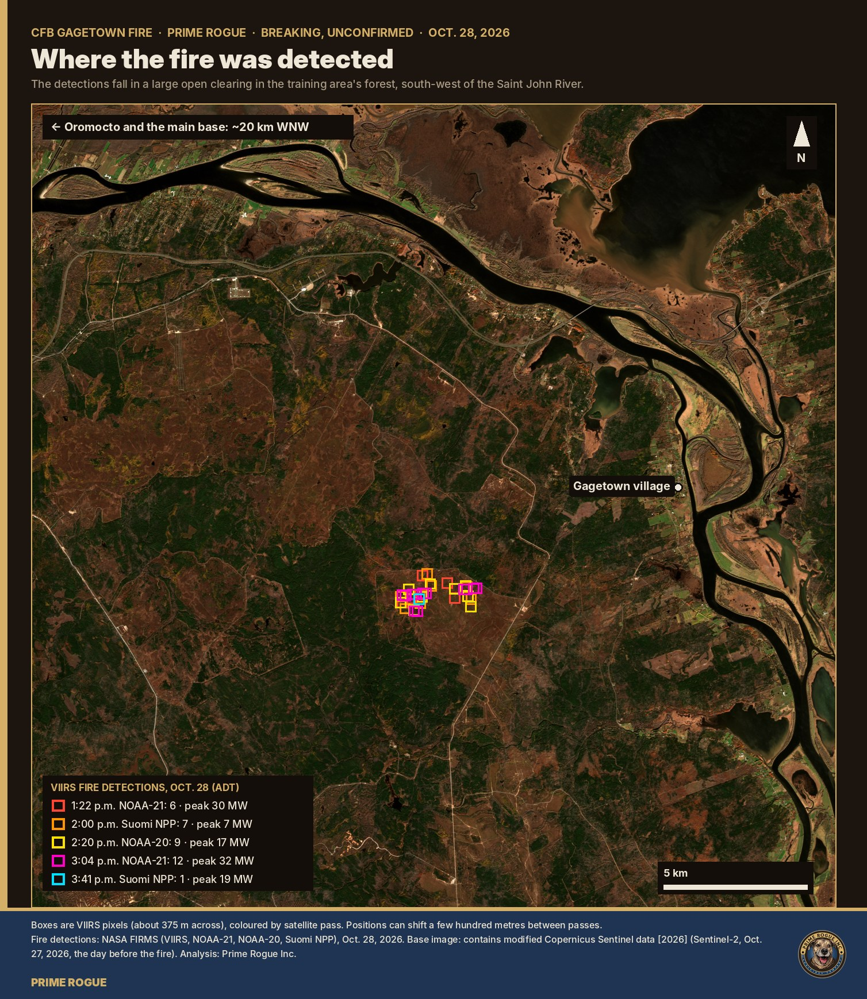

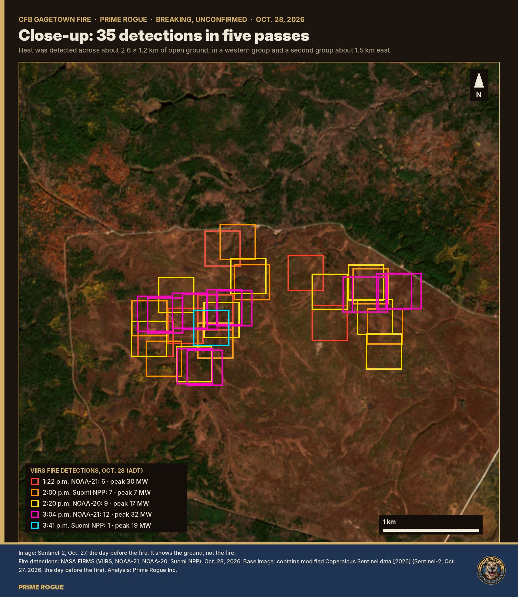

In short-wave infrared, the clearing shows as dry, sparsely vegetated ground, and every detection sits on it. The forest around it shows green.

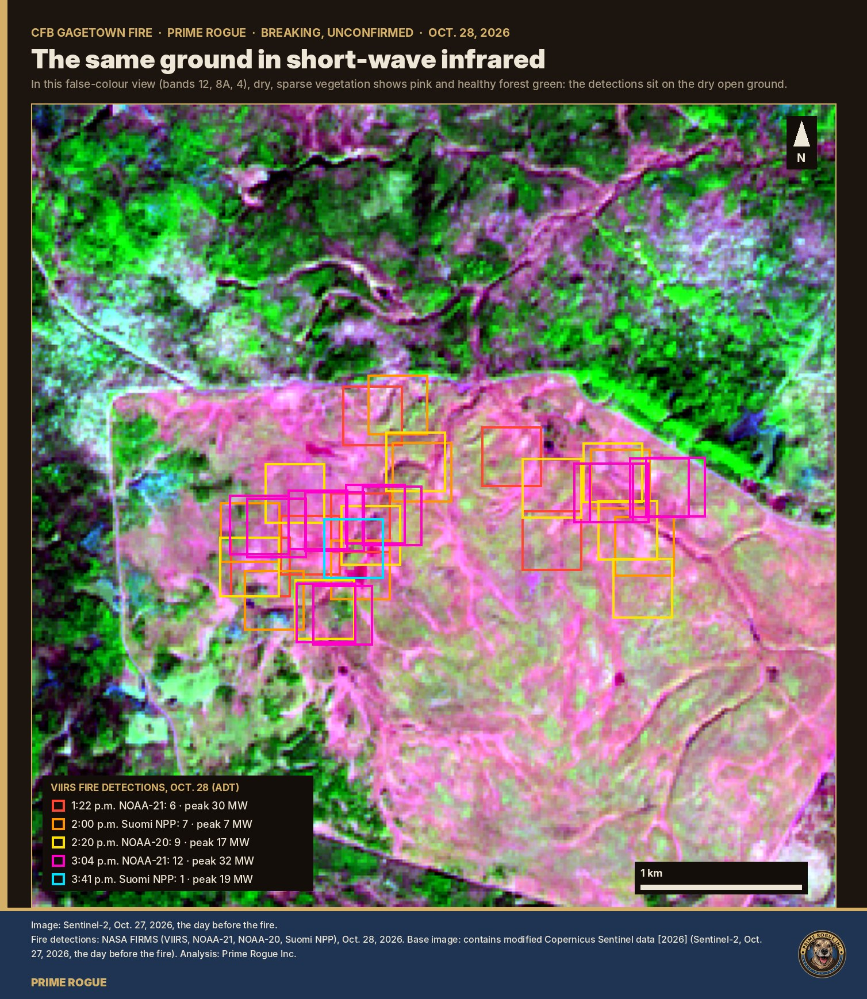

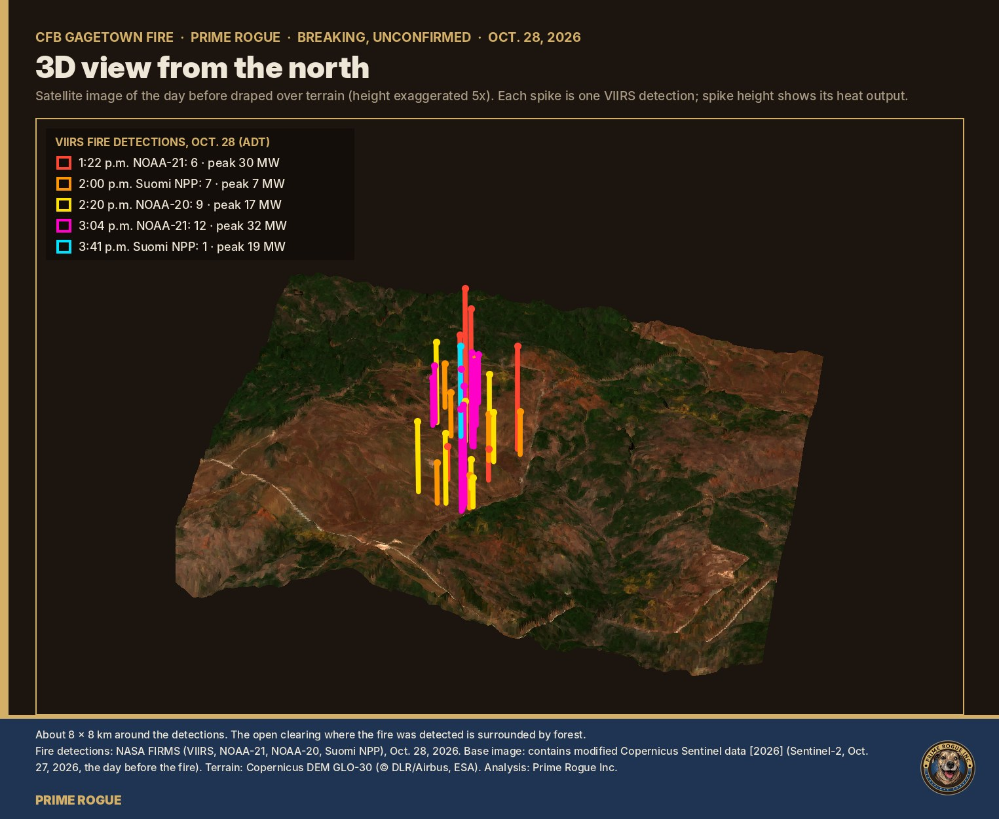

**Overnight: still warm.** VIIRS night passes at 3:57 and 4:15 a.m. on Oct. 29 found four more pixels, each 1–2 MW. That's smouldering or a small residual front, not an active run.

**Oct. 29: back up.**
- GOES-19 saw flame again from 12:11 to 12:51 p.m. at about 40–46 MW, and once more at 4:30 p.m.
- Five VIIRS passes between 1:05 and 3:21 p.m. found **13 detections**, peaking at 12 MW, about a third of the first day's intensity.
- Every one sat on the southern side of the first day's area, up to about 0.8 km beyond it. That suggests slow spread to the south, though pixel positions shift a few hundred metres between passes.
- None was recorded after 3:21 p.m. through to early Oct. 30.

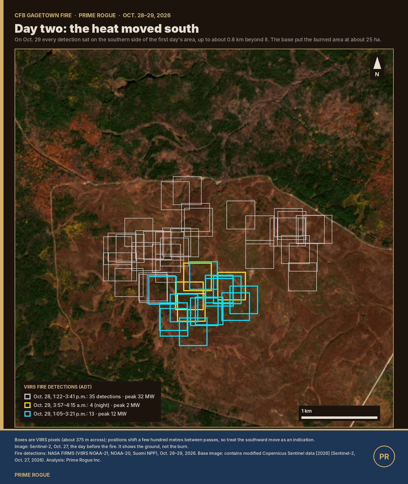

**The burn itself hasn't been seen yet.** The only clear optical image since the fire, a Sentinel-2 pass at 12:30 p.m. on Oct. 29, ends at the edge of its tile about 3 km west of the fire. The last clear image of the clearing is still the one from Oct. 27, the day before.

**Unusual for the place.** In the 60 days before Oct. 28, the same satellites recorded just one small detection anywhere in the training area: two pixels on Sept. 22, about 11 km to the north-west.

## How the story broke

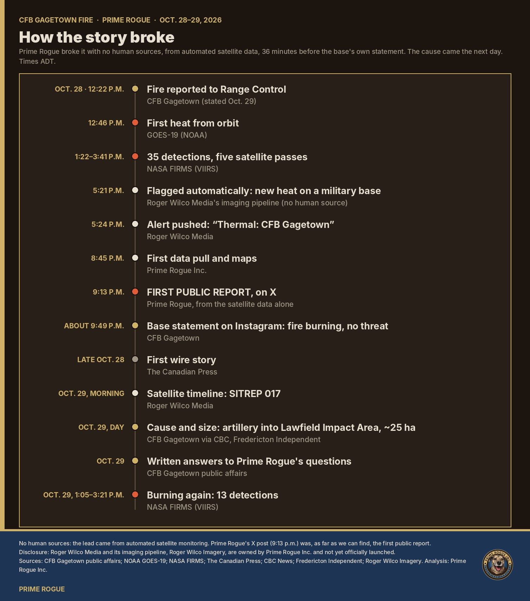

- **12:22 p.m., Oct. 28:** fire reported to Range Control, per the base.
- **12:46 p.m.:** first heat from orbit (GOES-19).
- **1:22 p.m.:** first NASA FIRMS (VIIRS) detections.
- **5:21 p.m.:** [Roger Wilco Media](https://rogerwilcomedia.online/), Prime Rogue's open-source satellite-monitoring service, flagged the fire automatically as a new heat source on a military base. It listed it on its public site that evening.
- **About 9:49 p.m.:** CFB Gagetown posted a statement on Instagram. It said a wildfire was burning in the northeastern sector of the training area, monitored by Wildland Fire Management Services, with no threat to nearby communities, and that training nearby was suspended.
- **Late Oct. 28:** [The Canadian Press](https://www.ctvnews.ca/atlantic/new-brunswick/article/fire-at-new-brunswick-military-base-not-threat-to-public-defence-officials/) reported the fire, citing defence officials who said it was no threat to the public.
- **Morning of Oct. 29:** Roger Wilco Media wrote up the satellite timeline in [SITREP 017](https://rogerwilcomedia.online/report/RWI-SITREP-017.html): GOES-19's first heat, the five passes, the peak and the spread. It flagged that the cause had not been given. A build failure on its site kept the report offline until that evening.
- **Oct. 29, during the day:** the [Fredericton Independent](https://ftonindependent.substack.com/p/wildfire-burning-at-base-gagetown) reported the base's statement. The base's afternoon update to reporters gave the cause and the 25-hectare figure ([CBC News](https://www.cbc.ca/news/canada/new-brunswick/wildfire-base-gagetown-9.7401802); [Fredericton Independent](https://ftonindependent.substack.com/p/base-gagetown-wildfire-still-active)). Roger Wilco Media's [SITREP 018](https://rogerwilcomedia.online/report/RWI-SITREP-018.html) followed that night with the second day's detections.

Reports disagree on the fire's status on Oct. 29. The Canadian Press described it as under control. The base's own answers say it "remains active."

## Why the timing matters

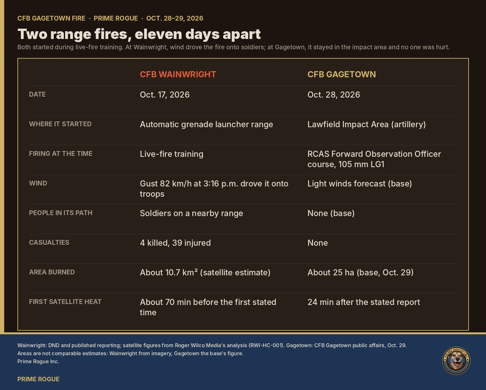

Wainwright still hangs over every range fire.
- The Oct. 17 fire there started on an automatic grenade launcher range, and a wind shift drove it onto soldiers on a nearby range. Roger Wilco Media's satellite analysis put the first heat about 70 minutes before the ignition time officials first gave.
- At Gagetown the picture is different: the fire was in an impact area, no one was in its path, and the base says it was seen and reported almost at once.

But some of the same questions apply:
- why live artillery was firing into dry autumn ground under a Moderate rating;
- what the 12:15 p.m. restrictions covered;
- what, if anything, changed after Wainwright.

The base answered the first in general terms and referred the last to "the appropriate authorities."

## A note on times

Prime Rogue's second set of questions to the base, sent Oct. 29, gave the first satellite pass as 12:22 p.m. ADT. That was our error: the first VIIRS pass was at 1:22 p.m. The base's answer gives 12:22 as the time the fire was reported to Range Control, and puts the training restrictions at 12:15 p.m., seven minutes earlier. Because the base's time matches our mistaken one, we are asking it to confirm that both times come from Range Control's own records. We will update this story with its answer.

## Sources and method

- **Fire detections:** NASA FIRMS (VIIRS on NOAA-21, NOAA-20 and Suomi NPP), near-real-time, Oct. 27–30.
- **GOES-19:** the NOAA ABI fire product, via NOAA Open Data on AWS. The five-minute series was assembled by Roger Wilco Media.
- **Imagery:** Sentinel-2, Oct. 27 (contains modified Copernicus Sentinel data [2026]).
- **Terrain:** Copernicus DEM GLO-30.
- **Fire radiative power** measures heat output, not area burned.
- **Raw data and code:** every number above can be checked against the unaltered FIRMS responses, the merged tables and the scripts in Prime Rogue's public repository, [DND-BASE-FIRES-Beginning-10-28-2026](https://github.com/primerogueinc/DND-BASE-FIRES-Beginning-10-28-2026).
- **Disclosure:** Roger Wilco Media is run by Prime Rogue Inc.

*Prime Rogue Inc. is a member of the Canadian Association of Journalists. Corrections: kevin@primerogueinc.com.*
